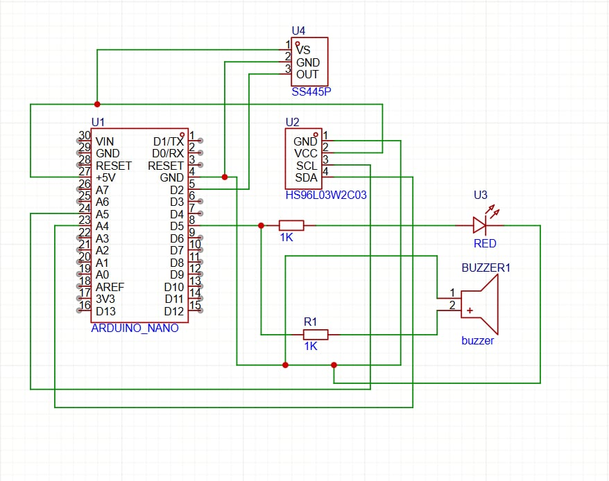

# Arduino-Based Coolant Flow Monitoring System

An Arduino-based prototype developed to monitor coolant flow and provide an audible warning when the measured flow falls below a predefined threshold.

## Project Overview

Maintaining adequate coolant circulation is important for the safe and reliable operation of cooling systems. This project explores a low-cost approach to monitoring liquid flow using an Arduino microcontroller and a Hall-effect flow sensor.

The system processes sensor pulses to estimate flow rate, provides visual feedback through an OLED display, and activates a buzzer when a low-flow condition is detected.

## Project Objectives

- Monitor liquid flow using a Hall-effect sensor.
- Estimate flow rate from sensor pulse measurements.
- Display flow information using an OLED screen.
- Provide an audible alert for low-flow conditions.
- Demonstrate an affordable embedded monitoring prototype.

## Hardware and Software

**Hardware**
- Arduino microcontroller
- Hall-effect water flow sensor
- OLED display
- Buzzer
- Connecting wires and supporting circuit components

**Software**
- Arduino IDE
- Embedded C/C++ programming

## Working Principle

1. Liquid passes through the flow sensor.
2. The sensor generates electrical pulses associated with flow.
3. The Arduino measures and processes these pulses.
4. The program estimates the liquid flow rate.
5. Flow information is displayed on the OLED screen.
6. The buzzer provides a warning when the programmed low-flow condition is detected.

## Circuit Diagram

## Prototype Setup

## Source Code

The Arduino sketch is available here:

[View Arduino Source Code](measurement.ino)

## Project Demonstration

A working demonstration video will be added here.

## Project Documentation

The detailed project report will be linked here after upload.

## Applications

- Educational coolant-flow monitoring prototypes
- Laboratory flow measurement demonstrations
- Arduino-based sensor and alarm systems
- Introductory embedded monitoring applications

## Notes

This project is presented as an engineering prototype. Measurement accuracy, sensor calibration and alarm performance should be assessed before use in safety-critical or industrial systems.
