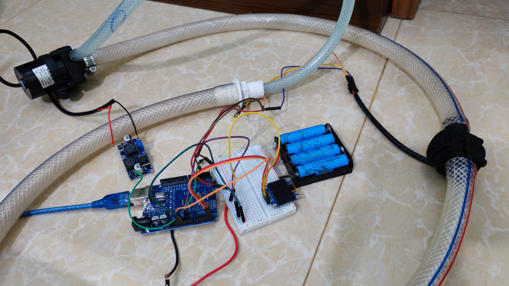

# Arduino-Based Coolant Flow Monitoring System

**A low-cost, Arduino-based prototype for monitoring liquid coolant flow using a Hall-effect sensor.**

**Course:** ME 376 – Control Engineering Sessional  
**Institution:** Military Institute of Science and Technology (MIST)  
**Project Type:** Group Engineering Project  
**Development:** September 2025

---

## 1. Project Overview

Maintaining adequate coolant circulation is essential for the reliable operation of thermal management systems. Insufficient or irregular flow can reduce cooling performance and contribute to overheating.

This project investigates an affordable coolant-flow monitoring approach using an Arduino microcontroller and a Hall-effect flow sensor. The sensor generates electrical pulses as liquid passes through it, allowing the microcontroller to estimate the flow.

The submitted project report describes an RGB LED-based flow-status indication system. The Arduino sketch available in this repository implements serial output, OLED display commands, and a buzzer-based threshold alert.

## 2. Project Objectives

- Develop a Hall-effect sensor-based coolant flow measurement system.
- Process sensor pulses using an Arduino microcontroller.
- Estimate liquid flow from sensor readings.
- Provide feedback about the monitored flow condition.
- Explore a low-cost solution for small-scale cooling applications.

## 3. Hardware and Software

### Hardware

- Arduino microcontroller
- Hall-effect water flow sensor
- DC water pump
- Connecting wires and breadboard
- Power supply
- Supporting electronic components

The project report also describes RGB LED indicators and associated resistors. The uploaded Arduino sketch includes an OLED display interface and a buzzer output.

### Software

- Arduino IDE
- Embedded C/C++
- EasyEDA (circuit design/simulation, as described in the report)

## 4. Working Principle

The monitoring process follows these steps:

1. A pump circulates liquid through the flow sensor.
2. The sensor generates pulses associated with the rotation of its internal turbine.
3. The Arduino detects these pulses using a hardware interrupt.
4. The program processes the pulse count to estimate liquid flow.
5. Flow information is sent through the serial interface.
6. The uploaded sketch also contains OLED display commands and buzzer threshold logic.

### System Flow

```text
        Liquid Flow
             |
             v
    Hall-Effect Flow Sensor
             |
       Electrical Pulses
             |
             v
       Arduino Controller
             |
       Pulse Processing
             |
       Flow Estimation
             |
       +-----+------+
       |            |
       v            v
 Serial / OLED   Buzzer Alert
```

## 5. Circuit Diagram

The following image shows the circuit documentation associated with the project.


## 6. Experimental Setup

The prototype uses a flow sensor integrated into a liquid-circulation arrangement. The Arduino receives sensor pulses and processes them to monitor flow.



## 7. Arduino Implementation

The uploaded Arduino sketch contains:

- Interrupt-based sensor pulse counting
- Serial flow-value output
- OLED display commands using Adafruit libraries
- A programmed buzzer threshold
- Periodic pulse-counter reset

**Source Code:**

[View Arduino Code](measurement.ino)

### Code Configuration

| Parameter | Value in Uploaded Code |
|---|---|
| Sensor input pin | Digital pin 2 |
| Buzzer output pin | Digital pin 9 |
| Serial baud rate | 19200 |
| OLED resolution | 128 × 64 |
| OLED I2C address | 0x3C |
| Flow calculation expression | `8.82 * pulse` |
| Buzzer condition | Calculated value greater than 1500 |

### Required Arduino Libraries

- Wire
- Adafruit GFX Library
- Adafruit SSD1306

**Technical note:** The current sketch calculates a value using a pulse-count multiplier. Its conversion to physical flow units requires confirmation against the sensor calibration factor and measurement interval. The buzzer condition in the uploaded code is triggered when the calculated value exceeds 1500, rather than when it falls below a low-flow threshold.

The OLED initialization and display-update implementation should also be reviewed before treating the sketch as a finalized measurement program.

## 8. Testing and Observations

The project report describes experimental trials using different pump operating conditions and comparison with reference flow measurements.

It reports:

- Flow measurement deviation below approximately ±3%
- Response to flow changes within approximately one second
- Flow-status indication using RGB LEDs

These are results documented in the project report. The raw measurement dataset and an independently verified calibration procedure are not included in this repository.

## 9. Project Report

The technical report contains the project background, objectives, hardware description, methodology, circuit documentation, implementation, and reported results.

**[View Full Project Report (PDF)](project%20report.pdf)**

## 10. Project Demonstration

The following video demonstrates the Arduino-based coolant flow monitoring prototype in operation.

▶️ [Watch Project Demonstration on YouTube](https://youtube.com/shorts/AUK-EnCW638)

## 11. Potential Applications

- Automotive cooling-system monitoring
- Laboratory liquid-flow measurement
- Small-scale thermal management systems
- Educational embedded-control projects
- Low-cost sensor monitoring demonstrations

The current implementation is an educational prototype and is not intended for safety-critical deployment without further validation.

## 12. Limitations and Future Improvements

The present work can be improved through:

- Sensor calibration using reference flow measurements
- More robust pulse-counting and time-window calculations
- Verification of flow-rate units and alarm thresholds
- Improved OLED initialization and refresh logic
- Testing across a wider operating range
- Data logging and remote monitoring
- Closed-loop pump-speed control

## 13. Project Team

Developed as a group project for **ME 376 – Control Engineering Sessional** at the Military Institute of Science and Technology (MIST).

**Team Members:**
- Maruful Islam Arnob
- Mahin Muntasim
- Mishbah Uddin Ahmed
- Md Al-Amin

## 14. Repository Contents

| File | Description |
|---|---|
| `measurement.ino` | Arduino source code |
| `circuit.jpg` | Circuit diagram |
| `setup.jpg` | Experimental setup photograph |
| `project report.pdf` | Technical project report |
| `README.md` | Project documentation |

---

**Disclaimer:** This repository documents an academic prototype. Reported performance and hardware descriptions should be interpreted in the context of the submitted project report and the currently uploaded source code.
